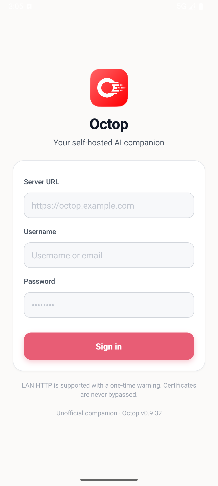

# Octop Mobile for Android

[](https://github.com/destinyme58/octop-mobile-android/actions/workflows/android.yml)

面向自托管 [Octop](https://github.com/TencentCloud/Octop) 的非官方 Android 客户端。
项目使用原生 Android 外壳承载 Octop 官方移动端 Web 应用，保留服务器端登录、
验证码、SSO、智能体、任务、知识库和文件能力，不需要跟随上游前端重复实现接口。

> **新版客户端（v1.1.0 起）**：仓库中的 [`octopmobile/`](octopmobile/) 是基于
> [huangcheng/OctopMobile](https://github.com/huangcheng/OctopMobile) `v1.0.0`
> 构建的独立 Release 版本，使用独立包名、版本号和签名，提供完整的原生移动端体验。
> 请从 [GitHub Releases](https://github.com/destinyme58/octop-mobile-android/releases)
> 下载最新 APK。下方原生 WebView 外壳是项目早期的 v1.0.x 实现，仅作为历史版本保留。

> Octop Mobile 与腾讯云及 Octop 官方无隶属关系，也未获得其官方背书。

<p align="center">
  
</p>

## 下载

前往 [GitHub Releases](https://github.com/destinyme58/octop-mobile-android/releases)
下载最新 APK。首次连接时，在应用内的“服务器设置”中填写自己的 Octop 地址，例如：

```text
http://octop.local:8088
```

v1.1.0 新版客户端使用独立 release keystore 签名，安装包、校验值和证书指纹见
[v1.1.0 发布说明](docs/releases/v1.1.0.md)。早期 v1.0.1 历史包仍使用 Android
debug 签名，仅用于存档。

## 功能

- 原生底部导航：对话、专家、任务和更多功能
- 可切换任意 HTTP/HTTPS Octop 服务器地址
- 下拉刷新、网络状态提示、断网错误页和快速重试
- 文件上传、下载及摄像头/麦克风权限桥接
- SSO `window.open` 授权弹窗支持
- Android 系统返回键、会话持久化和一键清除登录与缓存
- 中英文 Octop 页面原样加载，不注入账号密码

默认服务器为 `http://192.168.32.65:8088`。首次打开后使用 Octop 自己的登录页，
客户端会持久化 WebView 的登录状态。账号密码不会写入源码或 APK。

## 构建

环境要求：JDK 17+、Android SDK Platform 35、Build Tools 35.0.0。

```bash
./gradlew testDebugUnitTest
./gradlew assembleDebug
```

APK 输出：

```text
app/build/outputs/apk/debug/app-debug.apk
artifacts/Octop-Mobile_Android_universal_v1.0.1_20261025_debug.apk
```

执行 `assembleDebug` 或 `assembleRelease` 时，构建流程会自动把交付包导出到
`artifacts/`，并使用以下命名规则：

```text
Octop-Mobile_<平台>_<架构>_v<版本号>_<日期>_<构建类型>.apk
```

- 平台：Android；未来 iOS 的 `.ipa` 使用 iOS，不能与 APK 混用。
- 架构：当前没有原生 `.so` 库，因此是 `universal`。若以后引入 ABI 分包，再使用
  `arm64-v8a`、`armeabi-v7a` 或 `x86_64`。
- 版本号：来自 `app/build.gradle.kts` 的 `versionName`。
- 日期：默认按中国时区生成 `yyyyMMdd`；CI 可通过
  `-PbuildDate=20261025` 固定日期。
- 构建类型：`debug` 或 `release`。

示例：

```text
Octop-Mobile_Android_universal_v1.0.1_20261025_debug.apk
```

安装到已连接的手机：

```bash
adb install -r artifacts/Octop-Mobile_Android_universal_v1.0.1_20261025_debug.apk
```

当前构建已在 Android 15（API 35）模拟器中启动验证，能够连接默认的
`http://192.168.32.65:8088` 并进入 Octop 登录页。登录验证码需要用户在手机上完成。

界面快照：`artifacts/octop-login.png`

## 项目结构

```text
app/                     Android 应用源码、资源与单元测试
artifacts/               界面截图；APK 构建产物不会提交到 Git
.github/workflows/       GitHub Actions 持续集成
app/build.gradle.kts     版本号、构建配置和 APK 命名
CHANGELOG.md             版本变更记录
```

## 发布新版本

1. 在 `app/build.gradle.kts` 中递增 `versionCode`，并更新 `appVersionName`。
2. 更新 `CHANGELOG.md`。
3. 执行完整构建并确认测试、Lint 和 APK 签名通过。
4. 创建与版本号一致的 Git 标签，例如 `v1.0.1`。
5. 将 `artifacts/` 中对应 APK 上传到 GitHub Release。

## 网络说明

自托管 Octop 经常运行在局域网 HTTP 地址上，因此应用允许明文 HTTP。若服务暴露到
公网，建议使用 HTTPS，并在反向代理层配置有效证书、访问认证和防火墙规则。

客户端不会在源码或 APK 中内置 Octop 登录密码。账号密码、Cookie 和登录会话由
WebView 与所连接的 Octop 服务处理；卸载应用或清除应用数据会移除本地登录状态。

## 发布签名

仓库不包含签名密钥。发布到其他手机构建 release 版本时，请创建自己的 keystore，
通过 `signingConfigs` 或 CI 密钥注入签名信息，不要将 keystore 提交到版本库。

## 致谢

- [TencentCloud/Octop](https://github.com/TencentCloud/Octop) 提供自托管 Octop 服务及官方 Web 界面。
- AndroidX、Material Components 和 Gradle 社区提供 Android 基础组件与构建工具。
